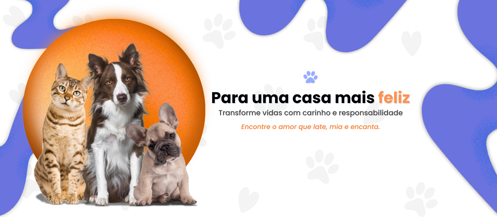

# AmigoPet

Site de adoção de cães e gatos, feito para um projeto do curso de Sistemas de Informação no SENAC.

**Site no ar:** https://luizajmm.github.io/Amigo-Pet/



## O que tem no site

A página mostra os animais disponíveis para adoção, com foto, nome e se são vacinados e castrados. Também explica como funciona a adoção, do formulário de interesse até a retirada do pet, e responde as dúvidas mais comuns, como documentos e prazos. No final tem os contatos (WhatsApp e Instagram) e a localização.

## Tecnologias

HTML e CSS, sem frameworks.

## Como rodar

Não precisa instalar nada. Baixe o projeto e abra o `index.html` no navegador:

```bash
git clone https://github.com/luizajmm/Amigo-Pet.git
```

---

Feito por [Luiza Júlia](https://github.com/luizajmm).
